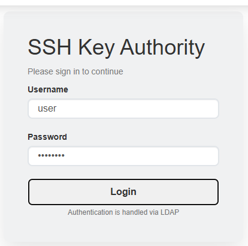
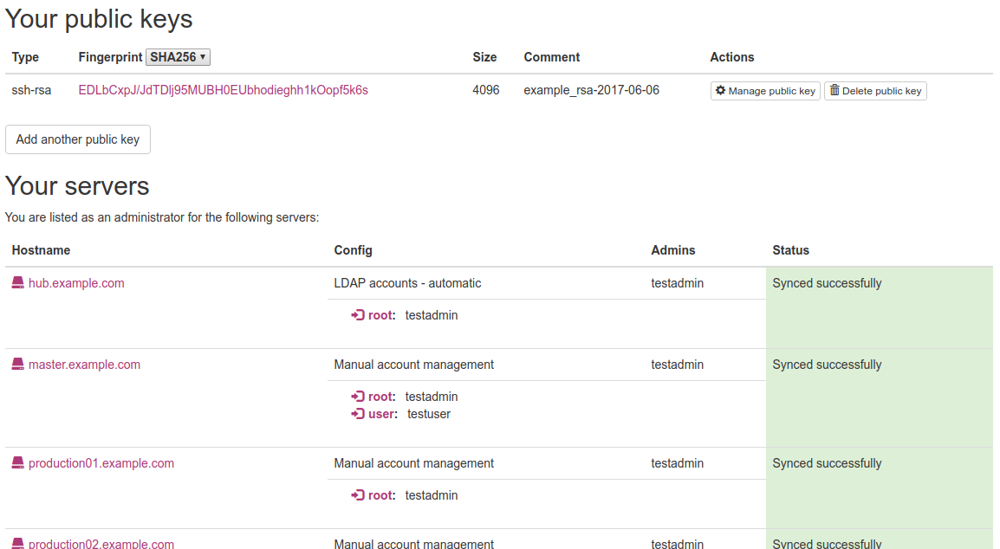
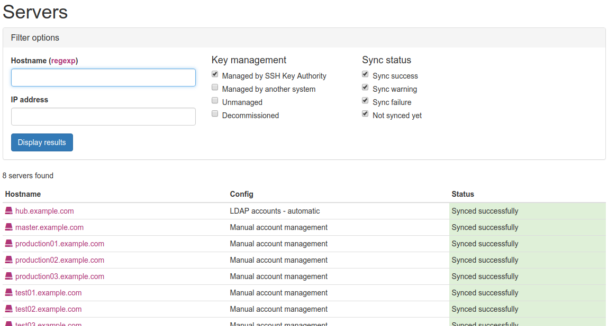
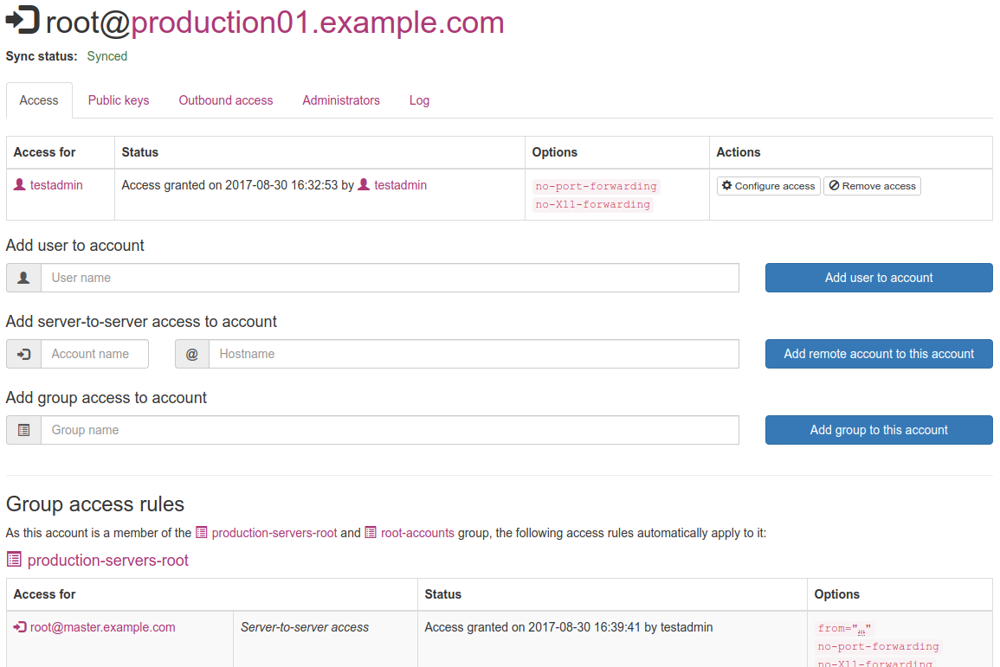
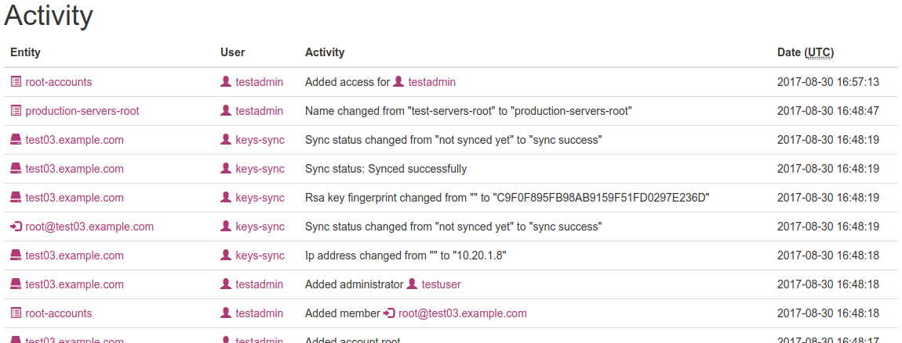
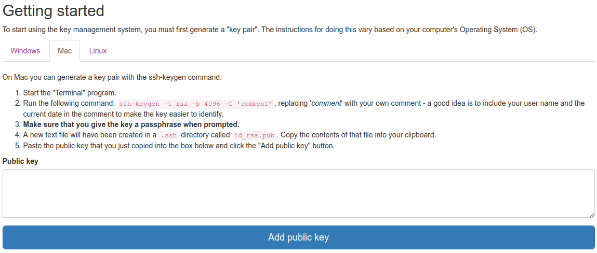

SSH Key Authority (SKA)
=======================

A web application for managing SSH access to any number of servers. Users upload their public keys, admins
and server leaders grant access per account, and SKA writes the resulting `authorized_keys` files to every
server over SSH. Users and groups come from LDAP / Active Directory.

This is a maintained fork of [Opera's SSH Key Authority](https://github.com/operasoftware/ssh-key-authority),
built on top of the work of [Leitwerk AG](https://github.com/leitwerk-de/leitwerk-key-authority). It runs on
PHP 8.2+ and is meant to be deployed with Docker.

*See [Security advisories](#security-advisories) for the issues fixed upstream.*

What this fork adds
-------------------

**Find out why someone can or cannot log in**
* **Troubleshoot access** (Tools menu, admins only). You give it a user or key, a server and a login name. It
  gives a verdict and draws the access path (user → groups → account → key file → server → login), marking
  where it breaks. It builds the key file with the same code the sync uses and checks it against what SKA last
  saw on the server.
* SKA records facts about each server during sync: the sshd configuration, key directory permissions and
  login accounts. The tool evaluates the sshd directives the way sshd does (first value wins, `Include`,
  `Match`). It points out blockers such as `AuthorizedKeysFile`, `AllowUsers`/`DenyGroups`, `StrictModes`,
  `PermitRootLogin` or a missing `PermitUserEnvironment`.
* Server pages show access that accounts inherit from groups ("via *group*"), not just the rules granted
  directly.

**Login and security**
* SKA has its own login page with sessions, so you no longer need HTTP Basic Auth or `mod_authnz_ldap` in
  front of it. The password is verified by binding as the directory entry found for the user. The form has
  CSRF protection and a limit on failed attempts, and the idle timeout can be set (`session_timeout`).
* Failed logins give clear reasons without helping anyone probe for accounts. Until the password is verified,
  the message is always the generic "invalid username or password". After that, the user is told the actual
  cause, such as an expired password, a disabled account or a missing LDAP attribute.
* Minimum key sizes are set per algorithm in `config.ini` (`min_rsa_bits`, `min_ecdsa_bits`,
  `min_ed25519_bits`).

**Managing keys and servers**
* Admins can add public keys for other users and delete them.
* Setting a server to *decommissioned* removes all user key files from it, so access is revoked rather than
  left behind.
* SKA can add a username variable to synced keys (default `BASH_HISTORY_USERNAME={uid}`), so shell history
  on shared accounts can be traced back to a person. This can be set globally and changed per server.
* Fixes to the inherited sync code:
  * Hostname verification works again.
  * On "manual LDAP" servers, the check that an account exists now really checks it.
  * SSH and SFTP errors are reported as failed syncs instead of crashing the sync.
  * A user with missing LDAP attributes no longer stops the LDAP update.

**Running it**
* Single-container Docker image (nginx, php-fpm, cron and the sync daemon), published for amd64 and arm64
  as [`msprg/ssh-key-authority`](https://hub.docker.com/r/msprg/ssh-key-authority).
* The version shown in the UI comes from the git tag, so it is never hardcoded.
* A setup script prepares target servers for SKA (see [Preparing target servers](#preparing-target-servers)).
* A responsive layout that works on phones.

### Compared with other versions

| | This fork | [Opera](https://github.com/operasoftware/ssh-key-authority) (original) | [Leitwerk](https://github.com/leitwerk-de/leitwerk-key-authority) | [mettke](https://github.com/mettke/ssh-key-authority) / [nisenbeck](https://github.com/nisenbeck/ssh-key-authority) |
|---|:-:|:-:|:-:|:-:|
| Login page in the app (no web server auth) | ✓ | – | – | – |
| Troubleshoot access tool | ✓ | – | – | – |
| Admins add / delete other users' keys | ✓ | – | – | – |
| Key files removed on decommission | ✓ | – | – | – |
| Username / history variable in keys | ✓ | – | – | – |
| Inherited access shown on server pages | ✓ | – | – | – |
| Configurable minimum key sizes | ✓ | – | – | ✓ |
| Detection of keys SKA does not manage | ✓ | – | ✓ | – |

*Based on the public repositories as of November 2026.*

Detecting unmanaged keys is Leitwerk's work. This fork also inherits Leitwerk's jump host support, bulk
server import, nested LDAP groups, access report page and CheckMK monitoring check.

Features
--------

* Manage SSH key access for all accounts on your servers, for users and for server-to-server access.
* Uses your LDAP directory for users and groups, and removes access automatically when people leave.
* Lets users upload their own public keys.
* Lets you name server leaders who manage access to their own servers.
* Supports group-based access rules and SSH options such as `command=`, `from=` and `no-pty`.
* Detects keys on your servers that SKA does not manage, with an allow/deny workflow.
* Logs every change to the database and syslog, and reports granted access by email.
* Notifies you when a server becomes orphaned (has no active leaders).

Quick start (Docker)
--------------------

1. Clone the repo and copy `docker-compose.yml.example` to `docker-compose.yml`. Set the database
   passwords. To use the published image instead of building one, remove the `build:` section. To pin a
   release, set `image: msprg/ssh-key-authority:<version>` (for example `1.6.0`).

2. Create `data/ska/config/config.ini` from `config/config.ini.example`. At a minimum set `[web] baseurl`,
   `[database]`, `[ldap]` (including `admin_group_cn`) and `[email]`.

3. Generate the key pair SKA uses to connect to servers, next to `config.ini` and in PEM format:

       ssh-keygen -b 4096 -m pem -f data/ska/config/keys-sync

   The sync daemon runs as `keys-sync` inside the container and must be able to read the private key. To
   avoid matching UIDs with the host, mount the pair as `config/keys-sync.host` and
   `config/keys-sync.pub.host` instead. The container then installs copies with the right owner at every
   start. This only works if `config/` itself is not mounted read-only.

4. Start it:

       docker compose up -d

   If you build the image locally, pass the version so that it shows in the footer:
   `SKA_VERSION=$(git describe --tags --always) docker compose up -d --build`.

The database schema is created and upgraded automatically. Members of the LDAP group `admin_group_cn` can
manage all accounts and servers.

Preparing target servers
------------------------

SKA connects to each server as the `keys-sync` user and writes one file per account into
`/var/local/keys-sync/` (for example `/var/local/keys-sync/root`). sshd has to read keys from there:

    AuthorizedKeysFile /var/local/keys-sync/%u
    StrictModes no

`StrictModes` must be off because the files are owned by `keys-sync`. This replaces `~/.ssh/authorized_keys`,
so existing keys there stop working unless you list both paths. `/var/local/keys-sync/keys-sync` must contain
the contents of `config/keys-sync.pub`, so that SKA can log in. To use the username variable in keys, sshd
also needs `PermitUserEnvironment yes`.

`Install SKA management.sh` does all of this for you: it creates the user, adds the sshd drop-ins, sets up
SELinux labels and tests the result. **Edit the public keys at the top of the script first**, because they
are the maintainer's own. It is a convenience script, not foolproof, and a mistake in the sshd configuration
can lock you out. Keep a second session open while you run it.

Bare-metal install (not recommended)

Requirements: PHP 8.2+ with the json, ldap, mbstring, mysql, ssh2 and pcntl extensions (gmp recommended),
Composer, a web server with PHP-FPM, and MySQL 8.0+ or MariaDB 10.11+.

1. Clone the repo outside your web root and run `composer install`.
2. Point the web server at `public_html/` and send every request that is not a file to `init.php` (for
   Apache: `DocumentRoot …/public_html`, `DirectoryIndex init.php`, `FallbackResource /init.php`). SKA
   handles login itself, so no authentication module is needed.
3. Create a database and user:

       CREATE USER 'ska-user'@'localhost' IDENTIFIED BY 'password';
       CREATE DATABASE `ska-db` DEFAULT CHARACTER SET utf8mb4;
       GRANT ALL ON `ska-db`.* TO 'ska-user'@'localhost';

4. Copy `config/config.ini.example` to `config/config.ini` and edit it. Generate `config/keys-sync` as in
   the Docker steps.
5. Run `scripts/ldap_update.php` and `scripts/supervise_external_keys.php` from cron. See `etc/cron.d/ska`
   for the schedule used in the image.
6. Install the sync daemon from `services/systemd/keys-sync.service` (or `services/init.d/keys-sync`). Set
   the path and user, then enable it.

Screenshots

Some of these predate this fork's interface changes.

Security advisories
-------------------

* [SKA security advisory: SSH port redirection attack](https://github.com/operasoftware/ssh-key-authority/wiki/SKA-security-advisory%3A-SSH-port-redirection-attack)
* [SKA security advisory: insufficient validation of group access rule edit privileges](https://github.com/operasoftware/ssh-key-authority/wiki/SKA-security-advisory%3A-insufficient-validation-of-group-access-rule-edit-privileges)
  (fixed in this fork)

License
-------

Copyright 2013-2017 Opera Software 
Modifications Copyright 2021 Leitwerk AG 
Maintenance, modifications and improvements by Msprg

Licensed under the [Apache License, Version 2.0](http://www.apache.org/licenses/LICENSE-2.0). Unless
required by applicable law or agreed to in writing, software distributed under the License is distributed on
an "AS IS" BASIS, WITHOUT WARRANTIES OR CONDITIONS OF ANY KIND, either express or implied. See the License
for the specific language governing permissions and limitations under the License.
