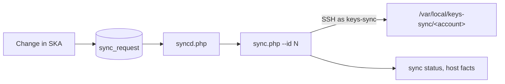

# How keys reach servers

The sync does not write to `~/.ssh/authorized_keys` on a target server. It writes one key file per account
into `/var/local/keys-sync/` on the server, and sshd is configured to read keys from there
(`AuthorizedKeysFile /var/local/keys-sync/%u`, see [Prepare target servers](../getting-started/target-servers.md)).
The only time SKA changes an `authorized_keys` file is when the key supervision script removes a key that was
denied (see [Unmanaged keys](../guide/external-keys.md)). This page describes how a change in SKA turns into
the files under `/var/local/keys-sync/`.



## Sync requests

Every change that can alter a key file adds a row to the `sync_request` table. A request names a server and,
optionally, a single account on it. A request without an account syncs the whole server.

Requests are created when:

- a server is added, or one of its settings changes: hostname, jumphosts, key management, accounts
  (authorization), history username environment mode or format, or its host key is reset;
- the LDAP access options of a server change;
- someone presses **Sync now** on the server page, or **Sync this server now and re-check** in
  [Troubleshoot access](../guide/troubleshoot-access.md#sync-this-server-now-and-re-check) (both only for
  servers whose keys SKA manages);
- an access rule is added to or removed from an account or a group, or its options change;
- a server account or group is activated or deactivated, or a member is added to or removed from a group
  (except with **Add multiple server accounts** on a group's Members tab, which queues no request);
- a user or server account adds or deletes a public key, or changes a key's signatures or destination rules;
- a user is activated or deactivated.

A change to a user or group syncs every account that it has access to, directly or through groups. A change
to a user also queues a request for that user's name on every server whose accounts are based on LDAP (see
[LDAP user key files](#ldap-user-key-files)). Changes made by `scripts/ldap_update.php`, such as a user
disabled in the directory, go through the same code and queue requests in the same way.

The table has a unique key on server and account name. A request for an account that is already queued or
being synced is therefore not added a second time. Requests for a whole server have no account name, and the
database does not treat those as duplicates of each other, so several of them can be queued at once.

## The sync daemon

`scripts/syncd.php` runs permanently. In the Docker image supervisord starts it as the `keys-sync` user with
`--systemd`; `services/` contains a systemd unit and an init script for other installations. Without
`--systemd` it must be started as root with `--user`, forks, drops to that user, and logs to
`/var/log/keys/sync.log`.

In a loop, pausing one second between rounds, it reads the requests that are not yet being processed and whose execution time is empty or
has passed. For each one it marks the request as in progress and starts `scripts/sync.php --id <server>`
(with `--user <account>` for an account request), up to about 20 processes at a time. Each process runs under
`timeout` with a limit of 60 seconds; set `timeout_util` in `[general]` to match the `timeout` command of the
host (see the [Configuration reference](../reference/configuration.md#general)).

When a process ends, the daemon deletes the request. If the process exited with a non-zero status, the
daemon sets the server's status to failure with the message "Internal error during sync" and schedules a
retry.

## Running a sync by hand

`scripts/sync.php` can be run directly, for example to test a new server. It needs `config/keys-sync` and
`config/keys-sync.pub` and must run as a user that can read them. `--host` (or `--all`) syncs servers in
child processes under the same 60-second `timeout` as the daemon, `--user` writes only one account's key
file, and `--preview` connects to nothing and prints the key files the sync would write. All options are
listed in [CLI scripts and JSON endpoints](../reference/cli-and-api.md#syncphp).

```bash
sudo -u keys-sync php scripts/sync.php --host web1.example.com --preview
```

A manual run does not pick up queued requests, but it records the sync status like the daemon does. A
failure replaces all queued requests of the server with a retry, as described under
[Failures and retries](#failures-and-retries). On a decommissioned server `--user` has no effect: the run
removes all key files as described below.

## Key management modes

What a sync does depends on the server's **Key management** setting.

| Setting | What the sync does |
| --- | --- |
| SSH keys managed and synced by SSH Key Authority | Writes and cleans up key files, as described below |
| Disabled - server has no key management | Nothing. It does not connect. |
| Disabled - SSH keys managed by another system | Nothing. It does not connect. |
| Disabled - server has been decommissioned (remove all user access keys) | Removes all key files except `keys-sync` and `.hostnames` |

!!! warning
    Switching a server to one of the two "Disabled" settings that are not "decommissioned" leaves the key
    files that are already on it in place, and they keep working. To take access away, use
    "decommissioned".

For a decommissioned server the sync checks that the key directory exists and is readable, lists it, and
deletes every file except `keys-sync` (the key SKA itself logs in with) and `.hostnames`. It reports
"Decommissioned: removed N key files (keys-sync access preserved)", or a failure and a retry if a file could
not be removed. Keys of accounts on a decommissioned server are also left out of the key files of other
servers that grant those accounts access.

## Connecting to a server

The sync connects with phpseclib as `keys-sync`, authenticating with `config/keys-sync`. Before and after
logging in it checks, in this order:

1. **IP address.** The hostname is resolved and the address stored. If another managed server has the same
   address, port and jumphosts, the sync stops with "Multiple hosts with same IP address".
2. **Host key.** On the first connection the server's host key is stored (trust on first use). Later
   connections fail with "SSH host key verification failed" if the key differs. After a legitimate change,
   an administrator (or a server leader, if `host_key_reset_restriction = 0`) resets the stored key, which
   queues a sync that stores the new one.
3. **Host key collision.** If another managed server has the same host key, the sync stops with "Multiple
   hosts with same host key.", unless `host_key_collision_protection = 0`.
4. **Hostname verification**, if `hostname_verification` in `[security]` is 1 or higher: the server must
   confirm its hostname in SKA through `hostname -f` or `/var/local/keys-sync/.hostnames`, depending on the
   level. A mismatch stops the sync with "Hostname check failed (allowed: ...)".

The levels and the other settings are described in the
[Configuration reference](../reference/configuration.md#security).

### Jumphosts

A server can be reached through a chain of jumphosts, written as `user@host[:port]` entries separated by
commas, for example `keys-sync@jump.example.com,keys-sync@inner.example.com:2222`. An optional
`-> alias` at the end gives the name used to reach the target instead of the hostname in SKA: the last
jumphost connects to that name, or SKA itself does if there are no jumphosts. The IP address check above
still resolves the hostname in SKA.

The tunnel is built with the system `ssh` client using the same `config/keys-sync` key. The jumphosts' own
host keys are **not** checked (`StrictHostKeyChecking=off`, `UserKnownHostsFile=/dev/null`); the target
server's host key is checked as described above.

## Writing the key files

For a server whose keys SKA manages, one sync goes through these steps:

1. Build the content of every key file in memory (see [What a key file contains](#what-a-key-file-contains)).
2. Connect and run the checks above.
3. List `/var/local/keys-sync/*` with `sha1sum` to learn which files exist and what they contain.
4. For each key file: if the checksum matches, log "No changes required"; otherwise write the file over SFTP
   and `chown` it to `keys-sync`.
5. On a full sync (not `--user`), delete every listed file that SKA did not generate, except `keys-sync` and
   `.hostnames`.
6. Read `/etc/uuid` if it exists and store it as the server's inventory UUID.
7. Record the sync status, write the [status file](#status-file) and collect the
   [host facts](#host-facts-snapshot).

A managed account gets a key file if it is active and is not only a pending access request. The file name is
the account name with any `/` removed. The `keys-sync` account never gets a file from the sync; that file is
set up by hand on the server.

The stale-file cleanup only sees what `sha1sum /var/local/keys-sync/*` prints: files whose names start with a
dot, and files `keys-sync` cannot read, are not removed. The sync needs a working SFTP subsystem for the
`keys-sync` user; if it does not work, the error says so.

### LDAP user key files

If the server's **Accounts** setting is "linked to LDAP and created automatically" (`automatic LDAP`) or
"based on LDAP usernames but created manually" (`manual LDAP`), the sync also writes a file for every SKA user
that has at least one key allowed on this server. The file is named after the user's uid and holds only that
user's own keys; access rules play no part in it. Each key line gets the server's LDAP access options
(`command`, `from`, `no-port-forwarding`, `no-X11-forwarding`, `no-pty`) as a prefix. If a managed account has
the same name, the managed account's file wins.

With `manual LDAP` the sync first asks the server whether the account exists, with `id -un -- <name>`:

- The account exists: the file is written.
- `id` says there is no such user: the file is removed (log line "Removed NAME, there is no such account on
  the server").
- The lookup cannot be run, fails otherwise, or does not finish in time: this counts as an error for that
  account and the file is left alone. The remaining lookups of that sync fail the same way without being
  tried, so one unresponsive server does not wait out the timeout for every user.

An all-digit name only counts as existing if `id` returns that same name, because `id` would otherwise
accept it as a numeric user id, which sshd does not.

!!! note
    A name service whose backend is down (a stopped sssd, for example) can answer "no such user" for every
    directory account, which looks exactly like accounts that are really gone. Whenever a sync removes files
    for this reason it schedules another sync in 30 minutes, so files removed during such an outage come
    back on their own. After creating an account on a `manual LDAP` server, sync the server.

With `automatic LDAP` there is no such check; the files are written whether or not the account exists yet.

## What a key file contains

`build_account_keyfile()` and `build_ldap_user_keyfile()` in `keyfile_common.php` build the content. The
sync, the Troubleshoot access tool and the permissions report all use these functions, so what the tool shows
is what the sync writes. Which rules apply to an account and whom a group covers is explained in
[Users, groups and access rules](access-model.md).

Every file starts with a header:

```text
## Auto generated keys file for account 'deploy'
## Do not edit this file! Modify at https://ska.example.com/servers/web1.example.com/accounts/deploy
```

LDAP user files say `for LDAP user 'jdoe'` and link to the SKA start page instead.

An account file then lists the keys of the rules of each group the account belongs to (rules of inactive
groups are skipped), followed by the account's own rules. A rule granted to a group expands to the keys of
its members, nested groups included. Only keys that are not deleted and whose destination rules (if any)
match the account name and hostname are written. With the default comments it looks like this:

```text
# === Start of rules applied due to membership in web-admins group ===
# ops group granted access by alice on 2026-03-02T09:15:00+00:00
# == Start of ops group members ==
# bob
environment="BASH_HISTORY_USERNAME=bob" ssh-ed25519 AAAAC3Nza...example Bob Example, 2026-01-10 08:00:00
# carol
# Account disabled
# == End of ops group members ==
# === End of rules applied due to membership in web-admins group ===

# dave granted access by alice on 2026-03-05T14:00:00+00:00
from="10.0.0.0/8",environment="BASH_HISTORY_USERNAME=dave" ssh-ed25519 AAAAC3Nza...example Dave Example, 2026-02-01 12:00:00
```

- **Options.** The options of an access rule (`command`, `from`, `no-pty` and so on) are written in front of
  every key that the rule lets in.
- **Inactive users** get no key lines. An inactive user who has keys still gets an LDAP user file, holding
  only the header (and `# Account disabled` with comments on), which replaces the earlier file.
- An inactive group named directly by a rule is not expanded; inactive groups further down are.
- **Server accounts** granted access appear as `# name@host` and, with the default comments, their keys
  carry `name@host` in the comment.

### Comments

`comment_key_files` in `[privacy]` decides how much the files reveal
(see the [Configuration reference](../reference/configuration.md#privacy)):

| Value | Effect |
| --- | --- |
| `0` | Key lines only, with no comment after the key and no `#` lines except the header |
| `1` | Owner name and key creation date after each key; `#` lines for groups, grantor and grant date, disabled accounts |
| `2` | Only a link to the key's page in SKA (`https://ska.example.com/pubkeys/<id>`) after each key |

### History username environment

SKA can add `environment="BASH_HISTORY_USERNAME=<uid>"` to every key line of a user, so that shell history
on a shared account can be traced back to a person. It applies to user keys in account files and in LDAP user
files, not to keys of server accounts. `history_username_env_default` and `history_username_env_format` in
`[privacy]` set the default; each server can inherit it, force it on or off, and override the format. The
format must contain `=` and `{uid}`; an invalid format falls back to `BASH_HISTORY_USERNAME={uid}`. If the
setting is missing from `config.ini`, it is off.

sshd only applies `environment=` options when `PermitUserEnvironment` allows it, and the variable does
nothing until the shell setup on the server uses it.

## Failures and retries

| Outcome | Server status message |
| --- | --- |
| Everything written and cleaned up | "Synced successfully" |
| Connection or one of the checks failed | The reason, for example "SSH host key verification failed" |
| The connection attempt hung until the 60-second limit | "SSH connection timed out"; when run by the daemon this may be followed by "Internal error during sync" |
| Some files could not be written, removed or (with `manual LDAP`) looked up | "N accounts failed to sync" |
| Some stale files could not be removed | "Failed to clean up N files" |

On any failure the sync deletes the server's pending requests and schedules one full sync 30 minutes later.
A new change in the meantime queues an immediate request as usual. If the connection fails, every managed
account of the server is marked as failed; if single files fail, only those accounts are.

The `sync warning` status still exists in the database and the UI, but the current sync never sets it.

Once connected, the sync ignores `SIGTERM` so that the timeout cannot leave a half-written directory; stopping
it needs `SIGINT` or `SIGKILL`.

## Where the status shows up

- The server page shows the last sync message, or "Pending" with a spinner while a request is due, and
  refreshes itself until the sync has finished. **Explain** links to the help on sync errors.
- The server list shows each server's status, and the home page and user pages show it for the servers
  that person leads. Each account on the server page shows "Synced", "Failed", "Not synced", "Requested" or
  "Pending".
- Every change of the status message is written to the server's log and to syslog.

### Status file

After each sync that got connected (also for decommissioned servers), and after each run of the key
supervision script, SKA writes a JSON file to `status_file_path` in `[monitoring]` on the server, by default
`/var/local/keys-sync.status` (see the [Configuration reference](../reference/configuration.md#monitoring)). It holds the sync status and message, any key supervision error,
the accounts with unnoticed [unmanaged keys](../guide/external-keys.md), and an expiry time
(`status_file_timeout` seconds ahead). Local monitoring can read it; see
[Monitoring and logs](../operations/monitoring.md).

## Host facts snapshot

The web application cannot open SSH connections, so the Troubleshoot access tool works from a snapshot that
the sync takes while it is connected anyway: the OS, the key directory (permissions, owner, checksums of the
files), the login accounts (uid, home, shell, groups) and the allowlisted sshd directives, with `Include`
files followed. It is stored in the `server_host_facts` table, one row per server.

Collection has a budget of 25 seconds, stops at the first failing command, and never fails the sync. If the
sync itself took 20 seconds or more, the snapshot is skipped and marked outdated instead. If collecting fails,
an older complete snapshot is kept. `scripts/supervise_external_keys.php` also renews the snapshot when it is
older than 15 minutes or marked outdated.

Everything in the snapshot comes from the target server and is treated as untrusted text.
