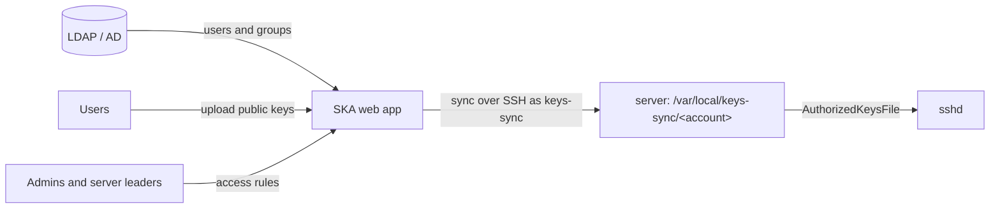

# SSH Key Authority

SSH Key Authority (SKA) is a web application for managing SSH access to any number of servers. Users upload
their public keys, administrators and server leaders decide who may log in to which account, and SKA writes
the resulting key files to every server over SSH. Users and groups come from LDAP or Active Directory, so
people who leave lose their access automatically.

This documentation covers the [Msprg fork](https://github.com/Msprg/ssh-key-authority). It builds on
[Opera's original](https://github.com/operasoftware/ssh-key-authority) and the work of
[Leitwerk AG](https://github.com/leitwerk-de/leitwerk-key-authority). It runs on PHP 8.2+ and is meant to be
deployed with Docker.

## How it works

1. Users log in to SKA with their directory account and upload their public keys.
2. Administrators add servers. Administrators and server leaders grant users, groups or other server accounts
   access to accounts on those servers.
3. The sync daemon connects to each server as `keys-sync` and writes one key file per account into
   `/var/local/keys-sync/`. sshd is configured to read keys from there.
4. When something changes (a key, a rule, a group membership in LDAP, a user leaving), the affected servers
   are synced again.

## Where to start

- **Setting it up:** [Install with Docker](getting-started/docker.md), then
  [prepare your target servers](getting-started/target-servers.md).
- **Understanding access:** [Users, groups and access rules](concepts/access-model.md) and
  [How keys reach servers](concepts/key-distribution.md).
- **Using it:** guides [for users](guide/users.md), [for server leaders](guide/server-leaders.md) and
  [for administrators](guide/administrators.md).
- **Someone cannot log in:** [Troubleshoot access](guide/troubleshoot-access.md).
- **Looking up a setting:** [Configuration reference](reference/configuration.md).

## What this fork adds

Compared with the original and the other public forks, this version adds:

- a [Troubleshoot access](guide/troubleshoot-access.md) tool that explains why a login works or not,
  including the server's sshd configuration;
- its own login page with sessions, so you no longer need HTTP Basic Auth in front of it;
- the ability for administrators to add and delete other users' keys;
- removal of all key files when a server is decommissioned;
- an optional username variable in synced keys, so shell history on shared accounts can be traced back to
  a person;
- group-inherited access shown on server pages;
- a Docker image published for amd64 and arm64.
